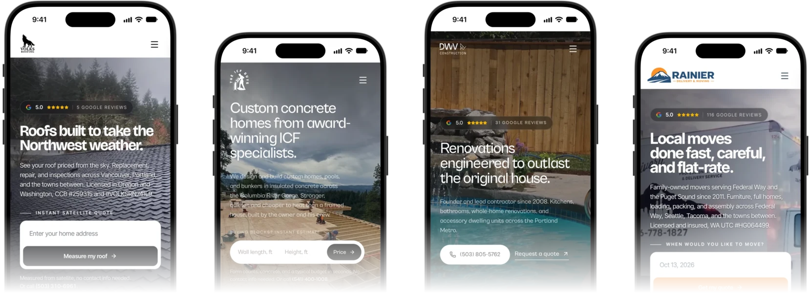
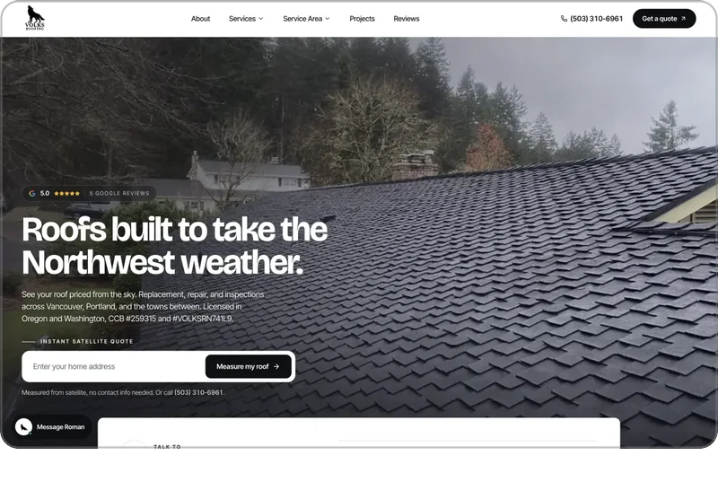
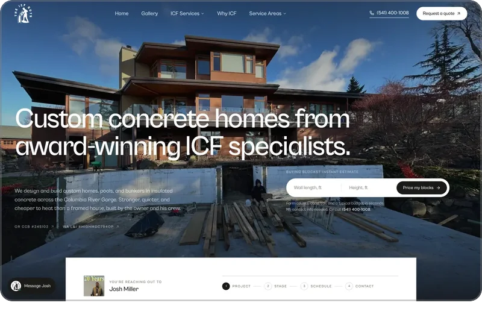
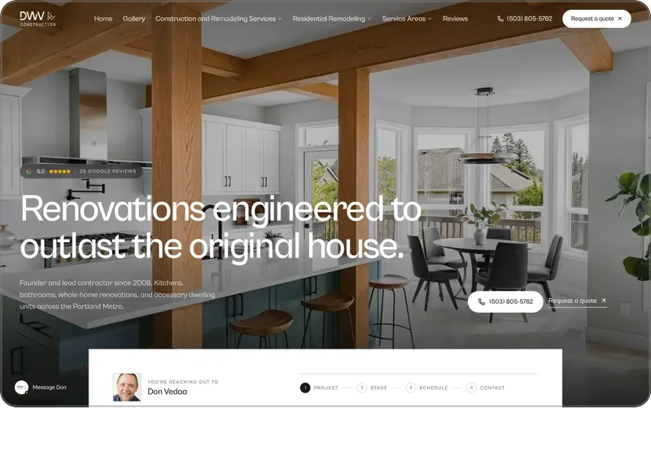
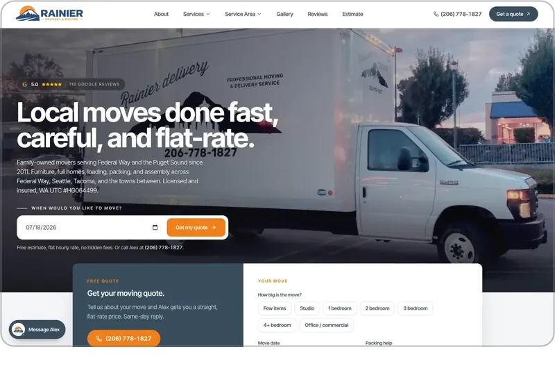
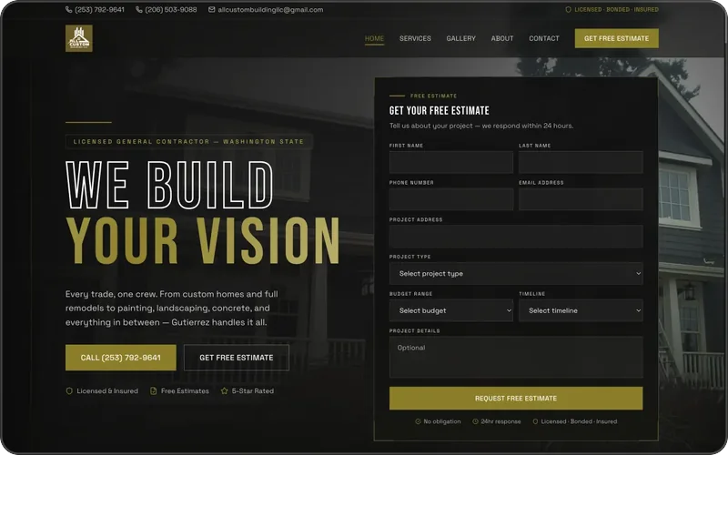
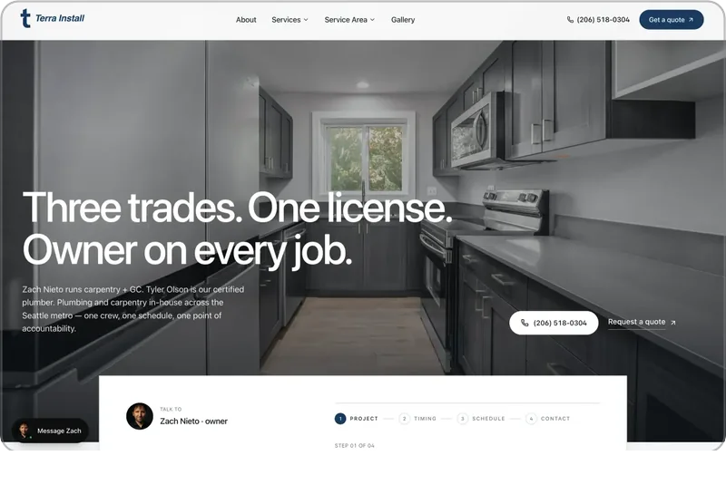

# Arseni Filon

Engineer and owner of [ePageUSA](https://epageusa.com) and [Contractor Marketing NW](https://contractormarketingnw.com). Seattle, Washington.

I build lead systems for contractors. A fast site, a quote tool for your trade, and Google Ads, built together by one engineer. Every lead is traced to its search.

## Systems I built. Open each one.

<a href="https://volksroofing.com"></a>

**Volks Roofing**  
<sub>Estimating engine, website, and lead pipeline</sub>

A homeowner types an address and gets a measured price for a new roof before anyone calls.

[volksroofing.com](https://volksroofing.com)

<br clear="left">

<a href="https://theicfguys.com"></a>

**The ICF Guys**  
<sub>Estimating engine, website, Google Business Profile, and Google Ads</sub>

An owner-builder enters a wall length and a height and gets form counts, concrete volume, and a budget range before anyone calls.

[theicfguys.com](https://theicfguys.com)

<br clear="left">

<a href="https://dwvconstruction.com"></a>

**DWV Construction**  
<sub>Website, permit check, and Google Ads</sub>

A search for a kitchen remodel in Portland lands on kitchens the company has already built.

[dwvconstruction.com](https://dwvconstruction.com)

<br clear="left">

<a href="https://rainierdelivery.com"></a>

**Rainier Delivery**  
<sub>Cost calculator and website</sub>

A customer picks the size of the move and sees the crew, the hours, and a price at once, before they send anything.

[rainierdelivery.com](https://rainierdelivery.com)

<br clear="left">

<a href="https://allcustombuildingllc.com"></a>

**All Custom Building**  
<sub>Website and cost calculator</sub>

Remodels, painting, landscaping, and new builds, with a cost calculator that shows a price range on the spot.

[allcustombuildingllc.com](https://allcustombuildingllc.com)

<br clear="left">

<a href="https://terragcnw.com"></a>

**Terra Install**  
<sub>Website and quote wizard</sub>

Three trades under one license in Burien, with a quote wizard that books the site walk.

[terragcnw.com](https://terragcnw.com)

<br clear="left">

24 client sites are live, from Seattle to Dubai.

## How it is built

TypeScript on Next.js, deployed to Cloudflare Workers, with a database at the edge and object storage for files. The iPhone apps are SwiftUI.

**First-party analytics and lead attribution.** Every lead is stored with the visit that produced it, and the owner reads it on his own dashboard.

A sample lead, as the site records it. The page is real. The customer is made up.

```text
search     icf builder white salmon
landing    /areas/white-salmon
project    ICF home
stage      Plans drawn up
estimate   Site walk, Thursday
source     multi-step-estimate-form
email      Site walk requested, in the builder’s inbox
```

Client code is private. The graph on this profile counts that work, and each site pictured above is live.

## Reach me

Email [filon@arseni.dev](mailto:filon@arseni.dev). I answer every message myself. On Instagram I am [arseni.dev](https://www.instagram.com/arseni.dev/).

For a site or a lead system, [get a written plan](https://contractormarketingnw.com/start). The pages, the towns, the tools, the price, and the dates come back on one page before you pay anything.
